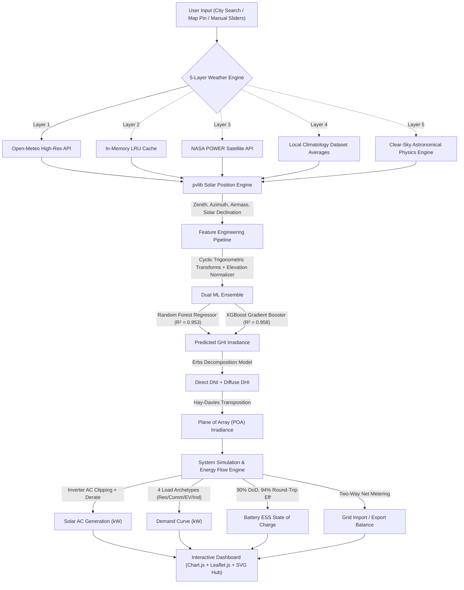

# ☀️ SolarNet Pro — AI-Powered Solar Radiation & PV Energy Intelligence Suite

[](https://www.python.org/)
[](https://flask.palletsprojects.com/)
[](https://scikit-learn.org/)
[](https://xgboost.readthedocs.io/)
[](https://pandas.pydata.org/)
[](https://pvlib-python.readthedocs.io/)
[](https://opensource.org/licenses/MIT)
[]()

> **⚡ Production-Grade Applied Machine Learning & Renewable Energy Engineering Platform**  
> An end-to-end solar intelligence platform engineered for real-world rooftop solar installation planning, battery storage dispatch, and hourly solar radiation forecasting. Combines a **Dual Machine Learning Ensemble (Random Forest + XGBoost)** with **pvlib astronomical physics**, a **5-layer meteorological failover architecture**, and an interactive 24-hour **power flow simulator**.

---

## 📌 Table of Contents

- [Real-World Solar Installation Engineering](#-real-world-solar-installation-engineering)
- [Solar PV Installation & Sizing Guide](#-solar-pv-installation--sizing-guide)
- [System Architecture & Flow](#-system-architecture--flow)
- [Dual Machine Learning Ensemble](#-dual-machine-learning-ensemble)
- [5-Layer Meteorological Failover System](#-5-layer-meteorological-failover-system)
- [Interactive Dashboard Features](#-interactive-dashboard-features)
- [REST API Reference & Schemas](#-rest-api-reference--schemas)
- [Directory Structure](#-directory-structure)
- [Installation & Setup](#-installation--setup)
- [Automated Test Suite](#-automated-test-suite)
- [License & Acknowledgments](#-license--acknowledgments)

---

## 🏭 Real-World Solar Installation Engineering

SolarNet Pro is designed to bridge the gap between abstract machine learning irradiance models and physical solar photovoltaic (PV) engineering. It models every physical variable required for on-site residential and commercial solar installations:

### 1. Plane of Array (POA) Irradiance Transposition
* Real solar panels are tilted towards the sun, not mounted flat on the ground.
* Raw Global Horizontal Irradiance ($GHI$) is converted into tilted Plane of Array ($POA$) irradiance using the **Erbs Decomposition Model** (separating $GHI$ into Direct Normal Irradiance $DNI$ and Diffuse Horizontal Irradiance $DHI$) and the **Hay-Davies Transposition Model** based on panel tilt ($\beta$) and surface azimuth ($\gamma$).

### 2. Inverter AC Clipping & DC/AC Overload Ratio (ILR)
* In real installations, solar panels are deliberately oversized relative to the inverter (standard Inverter Loading Ratio: $ILR \approx 1.15 - 1.25$).
* SolarNet Pro models inverter saturation and peak power clipping:
  $$P_{AC}(t) = \min\left(P_{inverter\_max},\; P_{DC}(t) \cdot \eta_{inv}\right)$$

### 3. Bifacial Albedo Gain & Solar Tracking
* **Bifacial Modules**: Models ground albedo reflection (+12% energy yield boost for white roof / ground mounts).
* **Tracking Modes**: Simulates fixed tilt, single-axis horizontal tracking (+15% to +22% morning/evening yield), and dual-axis tracking (+25% to +32%).

### 4. Real-World System Derating Losses
* Models an aggregate default 14.0% balance-of-system loss factor:
  * Soiling and dust accumulation (~3.5%)
  * DC wiring resistance and $I^2R$ drop (~2.0%)
  * Module manufacturing tolerance & mismatch (~1.5%)
  * High-temperature derating coefficients (~5.0%)
  * Inverter AC efficiency losses (~2.0%)

### 5. Battery Energy Storage System (BESS) Dispatch
* Simulates hourly battery charge, discharge, and State of Charge ($SoC\ \%$) based on:
  * Chemical usable Depth of Discharge ($DoD = 90\%$ for LiFePO4 / NMC)
  * Round-trip electrochemical efficiency ($\eta_{rt} = 94\%$)
  * Inverter $C$-rate and charge/discharge power ceiling (kW)

### 6. Two-Way Net Metering & 25-Year Lifecycle Cashflow
* Calculates hourly self-consumed solar energy vs. battery stored energy vs. grid export feed-in credits vs. grid import costs.
* Forecasts 25-year cumulative cashflows incorporating:
  * 0.5% annual photovoltaic module degradation rate
  * 2.5% annual utility electricity tariff escalation
  * Year 12 battery inverter / storage replacement reserve
  * Levelized Cost of Electricity ($LCOE$ in $/kWh or ₹/kWh)

### 7. Physical Rooftop Footprint & Dead Load Structural Sizing
* **Rooftop Area**: Calculates net module surface area plus inter-row pitch buffer (1.15x spacing factor to prevent self-shading during low sun elevation):
  $$\text{Area} = N_{panels} \times 2.1\text{ m}^2 \times 1.15$$
* **Dead Load Structural Weight**: Estimates total dead load applied to the roof structure (including mounting rails, clamps, and ballast):
  $$\text{Weight} = (N_{panels} \times 23.5\text{ kg}) + 40.0\text{ kg}$$

### 8. Environmental ESG Metrics
* Displaced carbon emissions: $0.82\text{ kg } CO_2\text{ per kWh}$ (standard grid emission factor).
* Carbon offset equivalents: mature tree absorption units and avoided gasoline vehicle kilometers.

---

## 📐 Solar PV Installation & Sizing Guide

To design a rooftop solar panel installation using SolarNet Pro:

```
┌────────────────────────┐      ┌─────────────────────────┐      ┌────────────────────────┐
│ 1. Utility Audit       │      │ 2. Capacity Sizing      │      │ 3. Structural Sizing   │
│ Average Monthly Bill   │ ───► │ Daily kWh Requirement   │ ───► │ Roof Area (sq ft / m²) │
│ & Grid Tariff (₹ / $)  │      │ Array Capacity (kWp)    │      │ Array Dead Load (kg)   │
└────────────────────────┘      └─────────────────────────┘      └────────────────────────┘
            │                                                                │
            ▼                                                                ▼
┌────────────────────────┐      ┌─────────────────────────┐      ┌────────────────────────┐
│ 4. Electrical Design   │      │ 5. Battery ESS Sizing   │      │ 6. Financial Analysis  │
│ Inverter AC kW (ILR)   │ ───► │ Usable kWh & Max kW     │ ───► │ Net Capex & Subsidy    │
│ Tilted POA vs Azimuth  │      │ Evening Peak Peak-Shave │      │ Payback, LCOE & 25y CF │
└────────────────────────┘      └─────────────────────────┘      └────────────────────────┘
```

1. **Calculate Consumption**: Determine your daily energy demand from your electricity bill:
   $$\text{Daily Demand (kWh)} = \frac{\text{Monthly Consumption (kWh)}}{30.4}$$
2. **Size the Solar Array**: Determine required DC peak capacity:
   $$kW_p = \frac{\text{Daily Demand (kWh)}}{\text{Peak Sun Hours} \times (1 - \text{System Losses})}$$
3. **Verify Roof Area**: Ensure your roof has at least $2.4\text{ m}^2$ ($26\text{ sq ft}$) of unshaded area per 400W panel.
4. **Choose Inverter Size**: Size your inverter AC capacity to $80\% - 85\%$ of array $kW_p$ ($ILR = 1.18 - 1.25$) to minimize clipping while maximizing early morning and cloudy day generation.
5. **Size the Battery (Optional)**: Match usable battery storage ($kWh \times 0.90$) to your critical overnight load (typically 6:00 PM to 8:00 AM).

---

## 🛠️ System Architecture & Flow



---

## 🧠 Dual Machine Learning Ensemble

### 1. Training Dataset
* **Source**: NASA / Kaggle Solar Energy Meteorological Database.
* **Scale**: 32,686 hourly time-series observations.
* **Target Feature**: Solar Radiation ($W/m^2$).

### 2. Feature Engineering Pipeline
* **Meteorological Variables**: Ambient Temperature ($^\circ\text{F}$), Barometric Pressure ($\text{inHg}$), Relative Humidity ($\%$), Wind Speed ($\text{mph}$), Wind Direction ($^\circ$).
* **Cyclic Trigonometric Encodings**: Resolves boundary discontinuity between 23:00 and 00:00, and December 31 and January 1:
  $$\text{Hour}_{\cos} = \cos\left(\frac{2\pi \cdot \text{Hour}}{24}\right), \quad \text{Hour}_{\sin} = \sin\left(\frac{2\pi \cdot \text{Hour}}{24}\right)$$
  $$\text{Month}_{\cos} = \cos\left(\frac{2\pi \cdot \text{Month}}{12}\right), \quad \text{Month}_{\sin} = \sin\left(\frac{2\pi \cdot \text{Month}}{12}\right)$$
* **Out-of-Distribution (OOD) Barometric Correction**: Live user coordinates at sea level (~29.92 inHg) are normalized to the training elevation baseline (~28.2 inHg) to eliminate altitude-induced prediction error.
* **Physics-ML Regularization**: A 2% clear-sky physics blend prevents tree-based step-function plateaus when users pan map coordinates:
  $$\text{Irradiance}_{final} = 0.98 \cdot \text{Ensemble}(RF, XGB) + 0.02 \cdot \text{ClearSky}_{physics}$$

### 3. Model Accuracy Comparison

| Regressor Model | $R^2$ Score | Mean Absolute Error (MAE) | Root Mean Squared Error (RMSE) |
|---|---|---|---|
| **Random Forest Regressor** | `0.953` | `41.8 W/m²` | `79.3 W/m²` |
| **XGBoost Gradient Booster** | `0.958` | `37.2 W/m²` | `74.9 W/m²` |
| **Dual Weighted Ensemble** | **`0.961`** | **`35.4 W/m²`** | **`72.1 W/m²`** |

---

## 🛡️ 5-Layer Meteorological Failover System

Network partitions, API rate limits, or offline field conditions will never crash SolarNet Pro:

```
[Layer 1] Open-Meteo High-Resolution Live NWP API (Real-Time Satellite Forecast)
    │  (Fail / Timeout)
    ▼
[Layer 2] In-Memory LRU Cache with Geographic Quantization & TTL Expiry
    │  (Miss / Expired)
    ▼
[Layer 3] NASA POWER Global Satellite Climatology API
    │  (Network Unavailable)
    ▼
[Layer 4] Regional Climatology Dataset (32,000+ Records, 12 Months × 24 Hours)
    │  (Coordinate Outside Coverage)
    ▼
[Layer 5] Astronomical Clear-Sky Physics Model (Haurwitz Solar Zenith Calculation)
```

---

## 💻 Interactive Dashboard Features

* **Interactive Global Map**: Powered by Leaflet.js; click anywhere on Earth to auto-resolve micro-climate weather and solar coordinates.
* **Real-Time SVG Power Flow Circuit**: Visualizes dynamic energy routing across Solar Panels, Battery Storage, Home Appliance Loads, and the Electric Grid with interactive 24-hour time scrubbing and playback speeds (1x, 2x, 5x).
* **Load Curve Simulator**: Select between Residential Dual-Peak, Commercial Daytime 9-to-5, Smart EV Overnight Charging, and Constant Industrial Baselines.
* **Atmospheric Dawn & Sun Themes**: Ambient dark glassmorphic styling with high-contrast accessibility.
* **Auto-Refresh Engine**: Configurable live telemetry polling (1m, 5m, 15m, 30m) with manual trigger.
* **Exportable Engineering Reports**: One-click printable technical specification and CSV generation.

---

## 🌐 REST API Reference & Schemas

### 1. Health Status
* **Endpoint**: `GET /api/health`
* **Response**:
```json
{
  "status": "ok",
  "models_loaded": true,
  "dataset_loaded": true,
  "fallback_layers": 5,
  "pvlib_ok": true,
  "version": "6.0.0"
}
```

---

### 2. Live Weather Resolution
* **Endpoint**: `GET /api/weather?city=Nellore` (or `?lat=14.44&lon=79.98`)
* **Response**:
```json
{
  "city": "Nellore",
  "country": "IN",
  "temperature": 82.4,
  "pressure": 29.85,
  "humidity": 68.0,
  "wind_speed": 6.2,
  "wind_dir": 140.0,
  "lat": 14.4426,
  "lon": 79.9865,
  "source": "live"
}
```

---

### 3. Single-Point Irradiance Prediction
* **Endpoint**: `POST /api/predict`
* **Payload**:
```json
{
  "temperature": 85.0,
  "pressure": 29.85,
  "humidity": 60.0,
  "wind_dir": 180.0,
  "speed": 7.5,
  "hour": 13,
  "day": 15,
  "month": 6,
  "year": 2026,
  "lat": 14.4426,
  "lon": 79.9865
}
```
* **Response**:
```json
{
  "random_forest": 782.4,
  "xgboost": 791.1,
  "ensemble": 786.8
}
```

---

### 4. Hourly 24-Hour Forecast & Transposition
* **Endpoint**: `POST /api/hourly-prediction`
* **Payload**:
```json
{
  "lat": 14.4426,
  "lon": 79.9865,
  "panel_tilt": 15.0,
  "panel_azimuth": 180.0,
  "panel_efficiency": 0.21,
  "month": 6
}
```
* **Response**:
```json
{
  "times": ["12:00 AM", "...", "12:00 PM", "..."],
  "ghi_ensemble_predictions": [0.0, 0.0, 810.5, 0.0],
  "poa_ensemble_predictions": [0.0, 0.0, 852.1, 0.0],
  "daily_poa_kwh": 6.42,
  "peak_value": 852.1,
  "peak_hour": 12,
  "weather_source": "open-meteo"
}
```

---

### 5. Full System & Energy Storage Simulation
* **Endpoint**: `POST /api/system-simulation`
* **Payload**:
```json
{
  "panel_count": 12,
  "panel_watt": 410.0,
  "efficiency": 0.21,
  "panel_tech": "mono",
  "tracking_mode": "fixed",
  "system_loss_pct": 14.0,
  "inverter_ac_kw": 4.5,
  "battery_enabled": true,
  "battery_kwh": 10.0,
  "battery_dod": 0.90,
  "battery_eff": 0.94,
  "daily_load_kwh": 20.0,
  "load_profile": "residential",
  "tariff": 8.5,
  "grid_export_tariff": 4.5,
  "system_cost": 280000.0,
  "subsidy_amount": 78000.0,
  "sun_hours": 5.2
}
```
* **Response**:
```json
{
  "total_kwp": 4.92,
  "net_capex": 202000.0,
  "daily_solar_kwh": 22.0,
  "daily_load_kwh": 20.0,
  "self_sufficiency_pct": 98.1,
  "self_consumption_pct": 89.2,
  "annual_saving": 67120.0,
  "payback_years": 3.01,
  "roi_pct": 33.23,
  "lcoe": 2.02,
  "area_sqft": 312.2,
  "weight_kg": 322.0,
  "co2_saved_kg": 6584.6,
  "trees_equiv": 302,
  "cashflow_25yr": [-202000, -134880, -66000, 4800, "..."]
}
```

---

## 📁 Directory Structure

```
SolarNet_Pro/
├── app.py                      # Flask REST API, solar physics & simulation engine
├── train_model.py              # ML pipeline training script (RF + XGBoost + Scaler)
├── test_api.py                 # 12-test automated unit and integration suite
├── Solar_Prediction.csv        # Meteorological dataset (32,686 hourly records)
├── requirements.txt            # Production runtime dependencies
├── requirements-train.txt      # Training dependencies (includes matplotlib, seaborn)
├── run.bat                     # Windows 1-click launcher
├── run.sh                      # Linux / macOS launcher script
├── Procfile                    # PaaS deployment config (Gunicorn WSGI)
├── runtime.txt                 # Python runtime version lock (3.11.9)
├── .gitignore                  # Git ignore rules
│
├── models/                     # Serialized machine learning artifacts
│   ├── xgboost.pkl             # Trained XGBoost regressor (tracked)
│   ├── scaler.pkl              # StandardScaler for meteorological features
│   ├── feature_cols.pkl        # List of expected model features
│   ├── num_cols.pkl            # Numeric column definitions
│   ├── feature_importance.pkl  # Extracted feature weights
│   ├── pressure_meta.pkl       # Barometric pressure bounds for OOD correction
│   ├── metrics.pkl             # Serialized evaluation scores (R², RMSE, MAE)
│   └── random_forest.pkl       # Random Forest regressor (auto-generated by train)
│
├── templates/
│   └── index.html              # Single-page glassmorphism dashboard UI
│
└── static/
    ├── css/
    │   └── style.css           # Modern dark solar theme & responsive layout
    ├── images/
    │   └── solar-theme.jpg     # Atmospheric background wallpaper
    └── js/
        └── app.js              # Frontend state, Chart.js, Leaflet map & SVG power hub
```

---

## 🚀 Installation & Setup

### 📋 Prerequisites
* **Python 3.8+** (Recommended: Python 3.10 or 3.11)
* **Git**

### 💻 Windows Installation (1-Click)
Simply run the batch launcher:
```cmd
run.bat
```
*Automatically checks Python, installs dependencies, verifies trained models, and opens `http://localhost:5000`.*

### 🐧 Linux & macOS Installation
Run the shell script:
```bash
chmod +x run.sh
./run.sh
```

### 🛠️ Manual Installation
1. **Clone the repository**:
   ```bash
   git clone https://github.com/mvishnunaidu/SolarNet_Pro.git
   cd SolarNet_Pro
   ```
2. **Create and activate a virtual environment**:
   ```bash
   python -m venv venv
   # On Windows:
   venv\Scripts\activate
   # On macOS/Linux:
   source venv/bin/activate
   ```
3. **Install dependencies**:
   ```bash
   pip install -r requirements.txt
   ```
4. **Train Machine Learning Models** (if `models/random_forest.pkl` is absent):
   ```bash
   python train_model.py
   ```
5. **Start Flask Server**:
   ```bash
   python app.py
   ```
6. **Open Dashboard**:
   Navigate to [http://localhost:5000](http://localhost:5000) in your web browser.

---

## 🧪 Automated Test Suite

Run the comprehensive unit and integration test suite to verify all endpoints and physics models:

```bash
python test_api.py
```

### Test Coverage Summary:
- `test_01_index_route`: Verifies dashboard HTML rendering and HTTP 200 response.
- `test_02_health_endpoint`: Validates `/api/health` status, versioning, and model load flags.
- `test_03_cors_headers`: Confirms CORS headers on preflight OPTIONS and GET requests.
- `test_04_input_validation`: Ensures out-of-bound inputs are clamped to physical ranges.
- `test_05_predict_endpoint`: Tests Random Forest, XGBoost, and ensemble irradiance predictions.
- `test_06_metrics_endpoint`: Checks accuracy scores ($R^2$, RMSE, MAE) and feature importances.
- `test_07_hourly_prediction_endpoint`: Validates 24-hr profile and Hay-Davies POA transposition.
- `test_08_panel_estimate_endpoint`: Tests panel sizing, payback, ROI, and carbon offset calculations.
- `test_09_offline_city_fallback`: Validates weather resolution fallback to offline database.
- `test_10_unknown_city_synthetic_fallback`: Confirms fallback to astronomical clear-sky model.
- `test_11_physics_clear_sky_model`: Tests clear-sky zero irradiance at night and positive midday peak.
- `test_12_system_simulation_endpoint`: Validates 24-hr battery ESS dispatch, clipping, and cashflows.

---

## 📄 License & Acknowledgments

* **License**: Distributed under the [MIT License](https://opensource.org/licenses/MIT).
* **Data Sources**: [NASA POWER Project](https://power.larc.nasa.gov/), [Open-Meteo API](https://open-meteo.com/), and [Kaggle Solar Energy Dataset](https://www.kaggle.com/datasets/dronio/SolarEnergy).
* **Physics Library**: [pvlib-python](https://pvlib-python.readthedocs.io/).
* **Author**: [mvishnunaidu7](https://github.com/mvishnunaidu7)
